# Laluan: a career GPS for the AI era

**Laluan** (Malay for "path") shows Malaysian workers and students how AI could change their work, which of their skills carry over, and a costed reskilling route to roles with a better outlook. Every number has a dated source you can open. You make the call; Laluan shows the evidence.

Team **Made in UTM** · XMUM Hackathon 2026 · **Domain 1: Aiversecity Future-Ready Workforce** · SDG 4 Quality Education, SDG 8 Decent Work

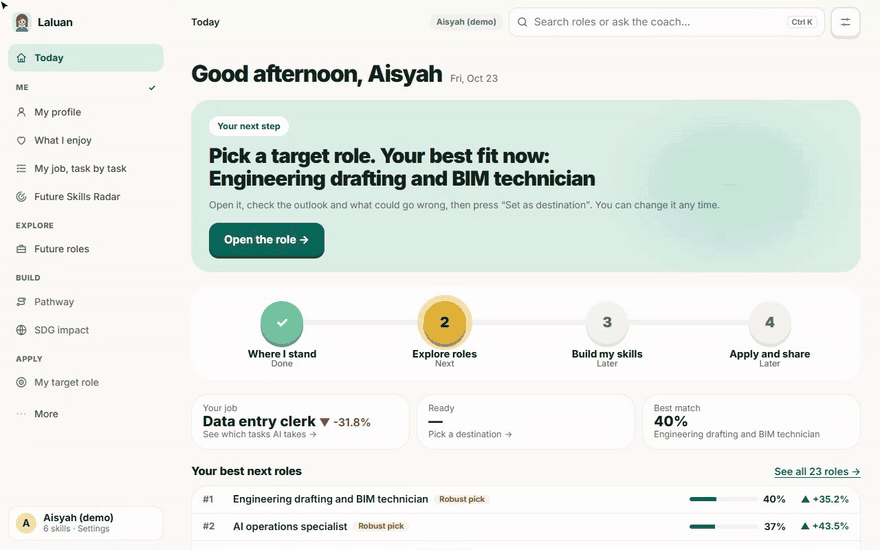

## Try it

**[laluan-psi.vercel.app](https://laluan-psi.vercel.app)**, no sign-up. One-click demos for each user group:

| Who | Open |
| --- | --- |
| Working adult at risk (Aisyah, data-entry clerk) | [Worker demo](https://laluan-psi.vercel.app/?demo=clerk) |
| Fresh graduate (Wei Jie) | [Graduate demo](https://laluan-psi.vercel.app/?demo=student) |
| Career switcher (Farid, call-centre agent) | [Switcher demo](https://laluan-psi.vercel.app/?demo=switcher) |
| HR and L&D team (190 synthetic staff) | [Company view](https://laluan-psi.vercel.app/?demo=hr) |
| TVET or university career centre (52 synthetic students) | [Class view](https://laluan-psi.vercel.app/?demo=class) |

> The API runs on Render's free plan. A scheduled ping keeps it awake from 07:00 to 23:00 Malaysia time; outside those hours the first click can take up to a minute, and the app says "Waking up the server…".

## The problem

AI is changing which jobs exist faster than training and skills frameworks can follow. In Malaysia, 56% of professionals already use AI at work but only 26% have had formal training (Hays Asia Salary Guide 2025), and MOSTI expects more than 600,000 workers to need reskilling within three to five years. A worker like Aisyah hears that AI is coming for her job, has a few hours a week and almost no budget, and gets two bad answers: a generic career quiz, or a chatbot that sounds sure and cites nothing.

**Who it is for:** working adults at risk of displacement, fresh graduates and career switchers, HR and L&D managers, and TVET and university career centres.

**What they walk away with:** in a few minutes, ranked future roles with an explainable match score and skills gap, three possible AI futures instead of one guess, an ordered plan of free or HRD Corp-claimable courses with hours and cost in RM, and how that path serves the UN SDGs. Every number traces back to a dated, public source.

## The six must-have features

| | Requirement | How Laluan delivers it | Where to see it |
| --- | --- | --- | --- |
| 1 | **Skills profile intake** | CV upload (PDF, Word, scan or photo), pasted text, three questions, voice, or a skill list. Names, emails, phone and IC numbers, addresses and employer names are removed **before any AI reads the text**, and the person sees exactly what will be sent. | Start with my skills |
| 2 | **AI-trend signal layer** | A pipeline collects arXiv research, Malaysian job ads (freehire.me, counted per role and per skill), Hacker News hiring threads, developer attention (Stack Overflow, GitHub, npm and PyPI), AI papers carrying a Malaysian institution, and OpenDOSM's labour-force, sector-employment and price series on top of the WEF Future of Jobs 2025 baseline. Each refresh becomes a **dated snapshot**, runs weekly from GitHub Actions, and **goes live only after a person approves it**. | Future Skills Radar, Sources |
| 3 | **Future-role matching** | 23 roles ranked by *0.6 × skill fit + 0.4 × outlook*. **Why this rank?** shows the breakdown; every role lists the skills you have and the ones you're missing. | Future roles, role page |
| 4 | **Personalised pathway** | Ordered courses for the missing skills, with hours, cost label and the date each link was checked. Free-only filter; HRD Corp-claimable programmes for workers. Tick a course and readiness updates. | Pathway |
| 5 | **SDG mapping** | Every role and skill is linked to an SDG target, with a written reason for each link. Pick an SDG and Laluan shows which role serves it and what that choice costs you in fit and outlook. | SDG impact, Future roles → Any SDG |
| 6 | **Handling uncertainty** | Slow, Baseline and Fast AI adoption, a free 0.5×–2× slider, a year slider, 80% ranges, *Likely* / *Uncertain* labels and a published backtest. Every forecast is labelled an estimate. | Radar, Future roles |

<table>
<tr>
<td width="50%"><b>1 · Personal details removed before any AI reads the CV</b><br>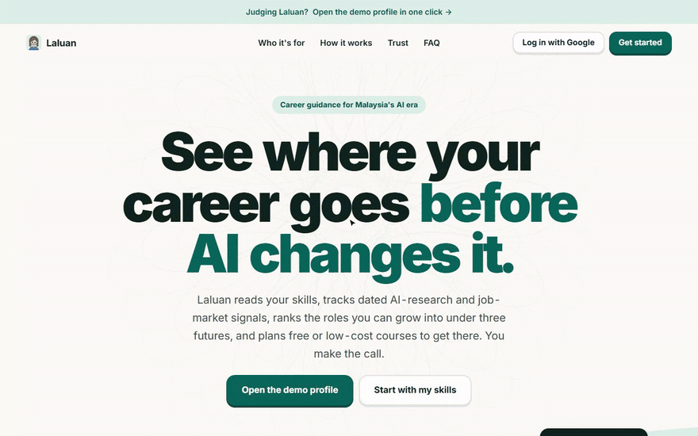</td>
<td width="50%"><b>2 + 6 · Future Skills Radar under three AI speeds</b><br>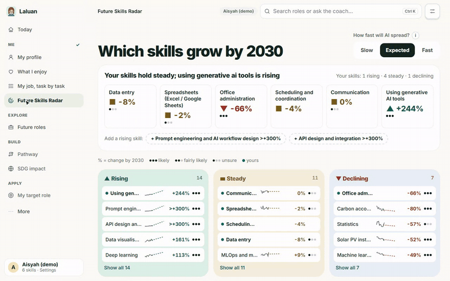</td>
</tr>
<tr>
<td><b>3 · Ranked roles with an explainable score</b><br>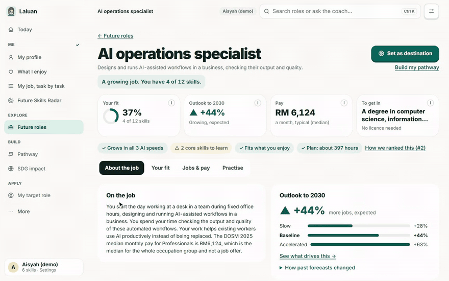</td>
<td><b>4 · An ordered, costed pathway</b><br>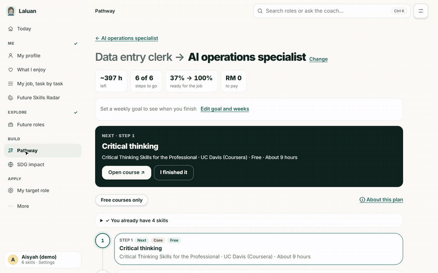</td>
</tr>
<tr>
<td><b>5 · Choose with a goal in mind</b><br>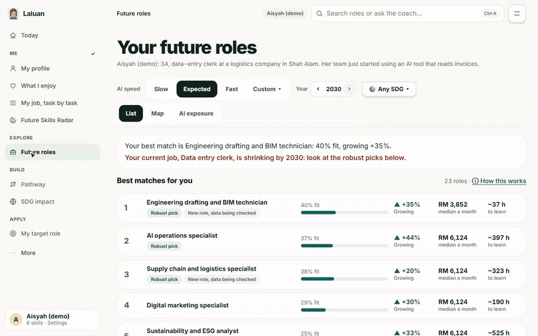</td>
<td><b>6 · Your own AI future and tipping points</b><br>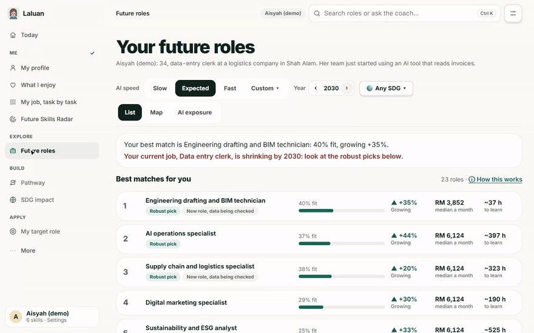</td>
</tr>
</table>

## What makes Laluan different

- **Forecast x-ray.** Tap any outlook and see every step from the published WEF figure to the number on the card: Malaysian job-ad demand, OpenDOSM employment, the monthly labour market, live postings for the role, the Malaysian sector shift, Malaysian AI research, AI research momentum and AI adoption, each with its source, snapshot and cap.
- **Your own tipping point.** Drag AI adoption from 0.5× to 2×. Laluan names the speed at which your current job turns *Declining* or another role overtakes your top match.
- **Output changes when the data changes.** When a newer forecast is approved, Today says which roles moved and offers to re-plan. Nothing switches without you.
- **Humans in charge.** A person approves every trend update (with a before/after table of every role that would move), the coach can only *suggest* a change that you then press **Apply** on, and every screen says "You decide". Laluan never ranks people for hiring.
- **A coach that checks itself.** It answers only from your own results with numbered sources. Every sentence is checked against them; unsupported ones are rewritten or removed, and the answer says so. Prompt-injection attempts get a calm refusal.
- **Fairness check.** Every sample profile and CV is run under eight names from Malaysia's communities, female and male. Rankings, scores, pathways and skills read from CVs must be identical. Shown on Sources and run in CI.
- **Built for Malaysia.** OpenDOSM pay and employment, TalentCorp MyCOL, MyMahir, HRD Corp, prices in RM, and English, Bahasa Malaysia and 中文 throughout.

<table>
<tr>
<td width="50%"><b>The coach answers from sources and checks itself</b><br>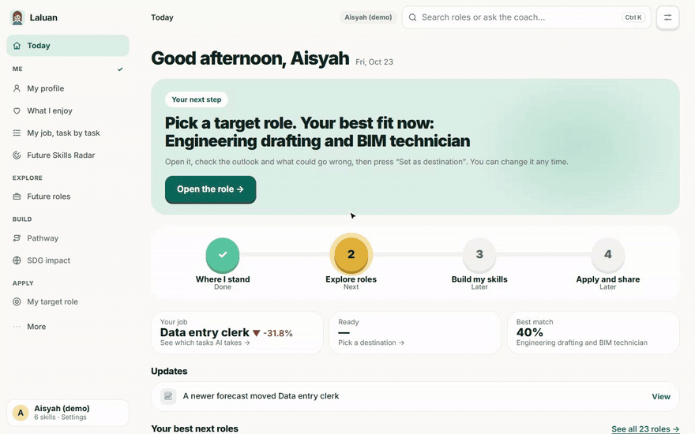</td>
<td width="50%"><b>New trend data re-ranks the roles; every snapshot is on Sources</b><br>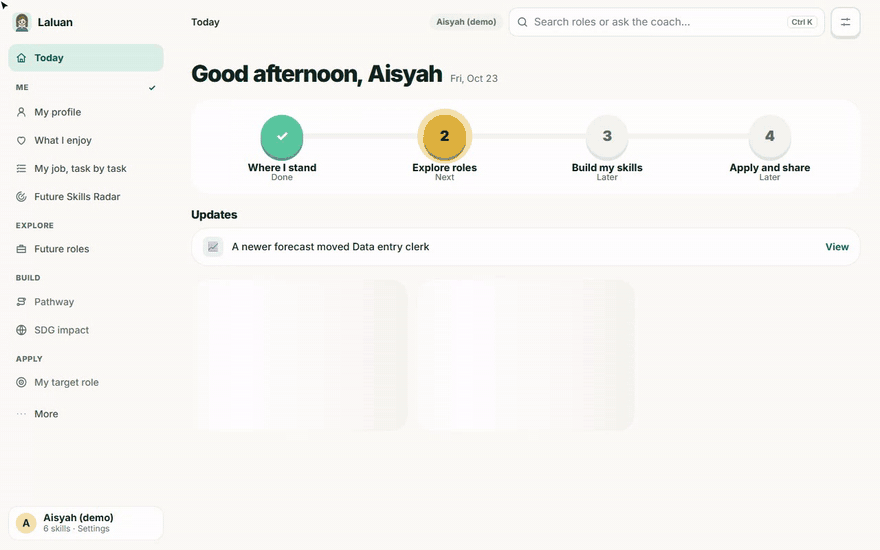</td>
</tr>
<tr>
<td colspan="2"><b>For HR teams: risk by role and the cheapest reskilling moves, totals only</b><br>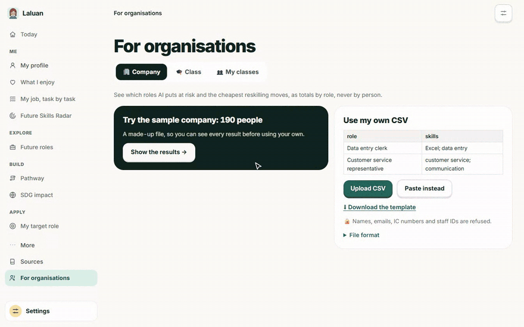</td>
</tr>
</table>

More: My job task by task, a skill tree with proof questions, interview practice, a career identity statement, live Malaysian job ads, a Future Card with QR code, progress tracking, a class view for career centres, a weekly email digest and a phone app. See **[every feature](docs/FEATURES.md)** and the **[user manual](docs/USER_MANUAL.md)**.

## How it works

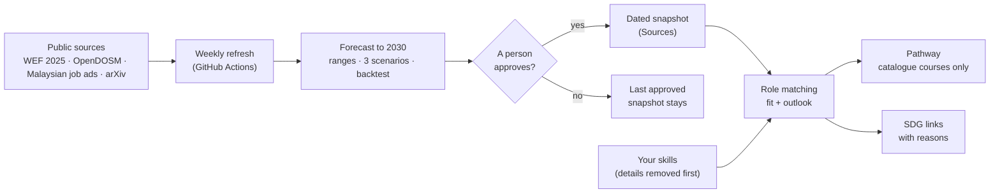

The route itself (matching, forecasts, scenarios, the x-ray, tipping points and pathways) is plain calculation over approved data, with no AI call, so it cannot invent a job, a course or a number. The details are in **[How Laluan works](docs/HOW_IT_WORKS.md)**.

## Hardest risk and our fallback

**Reliable, updatable trend data.** Job-ad and research counts are noisy proxies, and free APIs limit or refuse requests. Our own backtest says direction holds better than the "everything rises" guess (14 of 19 clear trends on 21 Oct 2026, against 12) but sizes are still rougher than a "no change" guess. So:

- noisy trends are shrunk towards no change and always shown with 80% ranges, and the backtest is published even where it is weak;
- every source is dated, and a refresh waits for a person; if collection fails, the last approved snapshot stays live (arXiv falls back to OpenAlex, then to a two-period comparison);
- AI cannot invent jobs or courses: pathway steps come only from our link-checked catalogue, job-ad quotes are matched sentence by sentence with no model involved, and emerging-role predictions need a real Google source and a person's approval, are labelled "A prediction" and are never ranked.

## AI disclosure and data

| | |
| --- | --- |
| **Language models** | **Google Gemini 3.8 Flash** for the coach, proof-check questions, interview feedback, the identity statement and survey reading. **Qwen 2.5 7B Instruct** (open model, on our RunPod worker) reads CVs first, so Gemini sees only confirmed skills. Our own OCR reads scans. The model in use is shown in the app. |
| **What AI never does** | Rank roles, calculate forecasts, choose courses or make a decision for you. With no API key, everything still works with rules and templates. |
| **Data** | Public or synthetic only: WEF Future of Jobs 2025, OpenDOSM (monthly labour force, employment by sector, consumer prices, salaries), DOSM Salaries & Wages 2025, O\*NET 30.0, TalentCorp MyCOL, freehire.me job ads, arXiv and OpenAlex, Stack Overflow, GitHub, npm and PyPI developer activity, the Anthropic Economic Index, OpenAI's "GPTs are GPTs" and the ILO 2025 index. All demo people, CVs, companies and classes are invented. See the [data sources (PDF)](docs/submission/Laluan_Data_Sources.pdf) and the [expansion record](docs/DATA_SOURCES_EXPANSION.md). |
| **Your data** | CVs are read in memory and never stored; only confirmed skills, goals and progress are saved. Download or delete everything from the app. |

## Run it locally

```bash
cd backend && python -m venv .venv && .venv/bin/pip install -r requirements-dev.txt
.venv/bin/python -m uvicorn app.main:app --port 8000      # Windows: .venv\Scripts\python.exe
cd frontend && npm install && npm run dev                  # http://localhost:5173
```

No API key is needed. Setup, configuration, deployment, tests (about 490 backend tests plus frontend tests, run in CI on SQLite and Postgres) and the project structure are in **[Developing Laluan](docs/DEVELOPMENT.md)**.

Stack: React 18 + TypeScript + Vite, FastAPI, Supabase Postgres and Auth (SQLite locally), Gemini and RunPod; Vercel and Render.

## Documents

- SDC submission: [Preliminary proposal](docs/submission/SDC2026_MadeInUTM_Preliminary.md) · [Technical tools declaration](docs/submission/SDC2026_MadeInUTM_TechDeclaration.md) · [Data sources (PDF)](docs/submission/Laluan_Data_Sources.pdf)
- Design: [PRD](docs/01-PRD.md) · [TRD](docs/02-TRD.md) · [App flow](docs/03-APP_FLOW.md) · [UI/UX brief](docs/04-UI_UX_BRIEF.md) · [Backend schema](docs/05-BACKEND_SCHEMA.md) · [Implementation plan](docs/06-IMPLEMENTATION_PLAN.md)
- How we built and checked it: [AI declaration](docs/AI_DECLARATION.md) · [Decisions](docs/DECISIONS.md) · [Review log](docs/REVIEW_LOG.md) · [Code to explain](docs/CODE_TO_EXPLAIN.md) · [Evaluation](docs/EVALUATION.md) · [Manual test plan](docs/MANUAL_TEST_PLAN.md) · [Data sources expansion](docs/DATA_SOURCES_EXPANSION.md)

## Team

**Made in UTM**

| Member | Role |
| --- | --- |
| ______ | ______ |
| ______ | ______ |
| ______ | ______ |

## Credits and licence

AI-exposure estimates from the [Anthropic Economic Index](https://huggingface.co/datasets/Anthropic/EconomicIndex) (CC BY), OpenAI's ["GPTs are GPTs"](https://github.com/openai/GPTs-are-GPTs) (MIT) and [ILO Working Paper 140](https://www.ilo.org/publications/generative-ai-and-jobs-refined-global-index-occupational-exposure) (CC BY 4.0); critical occupations from TalentCorp's [MyCOL 2024/2025](https://www.talentcorp.com.my/mycol/). Job growth figures from the [WEF Future of Jobs Report 2025](https://www.weforum.org/publications/the-future-of-jobs-report-2025/). Occupation tasks from [O\*NET 30.0](https://www.onetcenter.org/) (U.S. Department of Labor), used under CC BY 4.0. SDG names and colours from the United Nations. Landing page photos from [Unsplash](https://unsplash.com) by Gema Saputera, Mimi Thian and Vitaly Gariev; the people shown are not the demo personas.

Code under the [Apache License 2.0](LICENSE).
