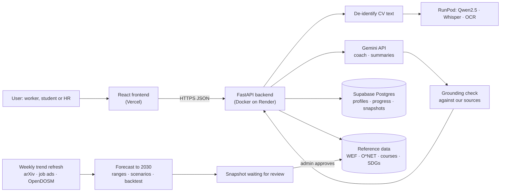

# SDC 2026 Hackathon · Phase 1: Preliminary Project Proposal

> Our answers to the official **SDC Hackathon Submission Template** (hosted by the XMUM AI Club; deadline 25 October 2026). This file is the source text; the submitted form is [`submission/SDC2026_MadeInUTM_Preliminary.pdf`](../../submission/SDC2026_MadeInUTM_Preliminary.pdf).

## 1. Team and project overview

| Field | Answer |
| --- | --- |
| Team name | Made in UTM |
| Selected domain | Domain 1: The Aiversecity Future-Ready Workforce |
| Selected SDG track (1–17) | **SDG 4** Quality Education (targets 4.3, 4.4), the domain's main SDG, with **SDG 8** Decent Work and Economic Growth (targets 8.2, 8.5) |
| Project / solution name | **Laluan** (Malay for “path”): a career GPS for the AI era |
| Name (leader) | Tan Hong Sheng |
| Email and phone (leader) | tanhongsheng050204@gmail.com (phone as on the registration form) |
| University affiliation(s) | Universiti Teknologi Malaysia (UTM) |
| Number of team members | 4 |
| Live prototype | <https://laluan-psi.vercel.app> |
| Code repository | <https://github.com/tanhongsheng050204-code/SDC-HACKATHON-2026---MADE-IN-UTM> |

## 2. Executive summary and problem statement

### 2.1 The problem context *(250 words max)*

AI is changing which jobs exist faster than training programmes and skill frameworks can keep up. In Malaysia, 56% of professionals already use AI tools at work, yet only 26% have had formal training (Hays Asia Salary Guide 2025, cited in the Domain 1 brief), and MOSTI expects more than 600,000 workers to need reskilling within three to five years. Globally, the World Economic Forum expects a structural churn of 22% of formal jobs by 2030 (170 million created, 92 million displaced), with clerical roles shrinking fastest: data entry clerks by about 26% and administrative assistants by about 20% (Future of Jobs Report 2025, Figures 2.1 and 2.3).

Those affected first have the least room to experiment: clerks, customer-service staff and other routine-task workers, graduates choosing a first job, and HR teams deciding whom to reskill. Today they rely on static career lists that date quickly, one-off assessments, or generic chatbots whose advice cannot be traced to any source.

This matters socially and economically. A worker who reskills too late loses income and confidence; a graduate who trains for a shrinking role wastes time and money; a company that guesses wrong spends its training budget on the wrong skills. What is missing is guidance that is **personal, current, explainable and honest about uncertainty**: it should show which skills carry over, which roles are likely to grow under different AI-adoption futures, and an affordable plan to get there, without making the decision for the person.

*Word count: 244*

### 2.2 The proposed AI solution *(300 words max)*

Aisyah, a data-entry clerk, learns her team adopted an AI invoice reader. Laluan takes her from “who I am today” to “where I can be in the AI era” in minutes.

1. **Skills in.** CV upload, questionnaire or skill list. Names, IC and phone numbers are removed *before* any AI reads the text; the file is never stored. She confirms the skills.
2. **Forecasts, not lists.** A re-runnable pipeline collects three years of job-ad mentions, AI-research papers (arXiv) and Malaysian employment (OpenDOSM). Each series becomes a damped trend to 2030 with an 80% range, flagged *emerging* when growth speeds up. A backtest on the last year is shown in the app. Every refresh is dated and **only goes live after a person approves it**.
3. **Three futures.** Slow, baseline and accelerated AI adoption change the forecasts and her ranked roles: 0.6 × skill fit + 0.4 × outlook. “Why this rank?”, a step-by-step forecast x-ray and **tipping points** (the adoption speed at which her job turns declining) explain every number.
4. **A plan she can start this week.** Ordered courses for missing skills, with hours, RM price and HRD Corp status from a curated catalogue; AI summaries are checked against it, so nothing is invented.
5. **SDG links with reasons** for every role and skill, and an **SDG lens** showing what choosing for a goal costs in hours and fit; an **AI coach** that only suggests, **automatic re-planning**, a public **fairness check** and an **HR view**.

Hardest risk: reliable, updatable trend data. Fallbacks: noisy trends shrink towards no change, ranges stay visible, arXiv falls back to OpenAlex, and the last approved snapshot stays live.

Workshops used: **GenAI APIs** (Gemini; Qwen2.5 and Whisper on RunPod; offline fallback), **database architecture** (Supabase Postgres) and **cloud deployment** (Vercel, Docker on Render, GitHub Actions).

*Word count: 299*

## 3. Technical architecture and implementation plan

### 3.1 Conceptual tech stack

| Layer | Technology |
| --- | --- |
| Frontend | React 18 + TypeScript + Vite; responsive; EN / BM / 中文; lite mode for slow connections |
| Backend API | Python 3.12, FastAPI, Pydantic, in a Docker container |
| AI | Google Gemini API (`gemini-3.8-flash` for text, `gemini-embedding-001` for embeddings); open models on RunPod Serverless: Qwen2.5-7B-Instruct (CV reading, so raw CV text stays away from Google), faster-whisper `small` (voice input) and our own OCR worker (scanned CVs); rules and templates when no key is set |
| Data | Supabase Postgres and Auth (profiles, progress, Future Cards, trend snapshots, review decisions; optional Google or Microsoft login); versioned JSON (roles, skills, courses, SDG map, O\*NET tasks) |
| Trend pipeline | arXiv with OpenAlex fallback (AI research); Malaysian job ads (freehire.me); Hacker News “Who is hiring?” threads; developer attention (Stack Overflow, GitHub, npm, PyPI); OpenDOSM labour force, sector employment, prices and salaries. Three years of history per series → damped-trend forecasts to 2030 with 80% ranges and a backtest (plain Python) |
| Hosting | Vercel (frontend), Render (API, Singapore), Supabase (Singapore), RunPod Serverless (open models), GitHub Actions (tests on every push, weekly trend refresh) |

**Sponsor resources:** **Yes.** **RunPod** (Domain 1 sponsor): Serverless endpoints run Qwen2.5-7B-Instruct for CV reading, faster-whisper for voice input and our own OCR worker for scanned CVs, so raw CV text and audio never reach Google. **Replit** (Domain 1 sponsor): development workspace and an alternative host for the same code. Gemini is used on Google's free tier; Vercel, Render and Supabase are on free plans.

### 3.2 Design-thinking and deployment strategy *(200 words max)*

**Empathise.** Personas from the brief's users: Aisyah, a clerk facing an AI invoice reader; Wei Jie, a final-year student; an HR team planning reskilling. Their fears set the tone: calm, honest, never alarmist.

**Define.** A ranked, explainable plan in under five minutes, every number traceable to a dated source.

**Ideate.** We rejected a pure chatbot because its answers cannot be checked. AI reads CVs and explains; forecasts come from public data with a published method.

**Prototype and test.** Live since Phase 1. Browser testing fed back into the design: a phone layout, a “server waking up” notice, human approval of trend data. A backtest exposed that plain trend lines overstate change, so we added shrinkage and damping. Every fix is in REVIEW_LOG.md.

**Deploy.** Vercel (frontend), Docker on Render (API), Supabase (data), tests on every push. It works without an API key. Phase 2: human evaluation with a counsellor and native speakers via the in-app review kit.

*Word count: 156*

## 4. Preliminary environmental and SDG impact framework

| Metric category | Our response |
| --- | --- |
| **Target SDG sub-target(s)** | **4.4** “By 2030, substantially increase the number of youth and adults who have relevant skills, including technical and vocational skills, for employment, decent jobs and entrepreneurship.”; **8.5** “By 2030, achieve full and productive employment and decent work for all women and men, including for young people…”. Supporting: 4.3 (affordable technical and vocational education), 8.2 (productivity through innovation). |
| **Current problem baseline** | Only **26%** of Malaysian professionals using AI at work have had formal AI training (Hays Asia Salary Guide 2025, as cited in the Domain 1 brief); **600,000+** Malaysian workers need reskilling within 3–5 years (MOSTI, same source); data-entry clerk jobs are projected to fall **≈26%** by 2030 (WEF Future of Jobs Report 2025, Fig. 2.3). For an individual today: no source-cited, personalised pathway exists in one place, so the share of recommendations a user can trace to a source is effectively **0%** in generic chatbot advice. |
| **Core measurable KPIs** | (1) Time from CV to a ranked, costed pathway (minutes). (2) Skill-extraction recall on 5 synthetic CVs marked by a person (%). (3) Share of role, skill, task and course recommendations that show a dated source (%). (4) Share of plan steps that are free or free to audit (%). (5) Reviewer agreement with the top-3 roles for the two personas (%). (6) Forecast backtest: share of clear skill trends whose direction held in the held-out year (%). |
| **Phase 2 impact target** | (1) ≤ **5 minutes** in a timed run. (2) ≥ **80%** average recall. (3) **100%** of recommendations cited (already enforced by automated tests). (4) ≥ **70%** of steps free or free to audit in both demo pathways (currently 2 of 2 for Aisyah and 1 of 1 for Wei Jie). (5) ≥ **70%** reviewer agreement from a lecturer or career counsellor. (6) Above the “everything rises” guess, re-measured at every refresh (21 Oct 2026: 14 of 19 clear trends held, against 12 for “everything rises”; sizes still rougher than a “no change” guess). |

**Sources:** World Economic Forum, *Future of Jobs Report 2025*, January 2025, Figures 2.1 and 2.3, <https://reports.weforum.org/docs/WEF_Future_of_Jobs_Report_2025.pdf>. SDC Hackathon, *Domain 1 Problem Statement & Marking Rubric* (citing Hays Asia Salary Guide 2025 and MOSTI). United Nations, *SDG targets 4.3, 4.4, 8.2, 8.5*, <https://sdgs.un.org/goals>.

## 5. Eligibility and readiness checklist

- [x] All team members have completed the mandatory GenAI, Database and Cloud Deployment upskilling workshops.
- [x] The project concept addresses a verified real-world problem mapped directly to one or more UN SDGs.
- [x] The proposed solution targets a functional, deployed application rather than a theoretical business case study.
- [x] All fields in this template have been completed within the word limits stated.

## 6. IP and originality declaration

### 6.1 Pre-existing / prior-owned work

**No.** All code, design and research in this submission were created during the SDC 2026 hackathon period.

### 6.2 Third-party code, datasets or models

**Yes.** All are open source or public and are used under their licences, with attribution in the README:

| Name | Type | Licence |
| --- | --- | --- |
| React 18.3.1, React DOM 18.3.1 | Code | MIT |
| Vite 5.4.11, @vitejs/plugin-react 4.3.4 | Code | MIT |
| TypeScript 5.6.3 | Code | Apache-2.0 |
| qrcode 1.5.4 | Code | MIT |
| @supabase/supabase-js 2.45.4 | Code | MIT |
| Inter font (via @fontsource-variable/inter 5.3.0) | Font | SIL OFL 1.1 |
| FastAPI, Starlette, Pydantic | Code | MIT / BSD-3 / MIT |
| Uvicorn, HTTPX, pypdf | Code | BSD-3 |
| psycopg 3, PyJWT | Code | LGPL-3.0 / MIT |
| RapidOCR, ONNX Runtime, pypdfium2, Pillow (our own OCR for scanned CVs) | Code | Apache-2.0 / MIT / Apache-2.0 or BSD-3 / MIT-CMU |
| python-multipart, google-genai SDK, runpod SDK | Code | Apache-2.0 / Apache-2.0 / MIT |
| PyMuPDF (only for the one-off WEF figure extraction script, not in the app) | Code | AGPL-3.0 |
| PaddleOCR PP-OCRv4 English text recogniser and RapidOCR's text detector | Model | Apache-2.0 |
| Google Gemini `gemini-3.8-flash`, `gemini-embedding-001` (called via API) | Model | Gemini API terms |
| Qwen2.5-7B-Instruct (Alibaba Qwen team), served with vLLM on RunPod Serverless | Model | Apache-2.0 |
| OpenAI Whisper `small` via faster-whisper, on RunPod Serverless | Model | MIT |
| O\*NET 30.0 task statements (U.S. Department of Labor) | Dataset | CC BY 4.0 |
| WEF Future of Jobs Report 2025, Figure 2.3 (figures cited, not redistributed) | Dataset | WEF terms of use, with citation |
| UN Sustainable Development Goals names, targets and colours | Dataset | UN SDG guidelines |
| arXiv API metadata counts; OpenAlex | Dataset | arXiv API terms; CC0 |
| OpenDOSM labour force, employment, prices and salaries (via data.gov.my) | Dataset | CC BY 4.0 |
| Hacker News “Who is hiring?” posts, counted via the Algolia HN API | Dataset | HN API terms (counts only) |
| Malaysian job postings via the freehire.me API | Dataset | freehire terms; project MIT |
| Stack Overflow, GitHub, npm and PyPI activity counts | Dataset | Each API's terms (counts only) |
| Anthropic Economic Index | Dataset | CC BY |
| OpenAI “GPTs are GPTs” occupation exposure scores | Dataset | MIT |
| ILO Working Paper 140, Annex Table A1 | Dataset | CC BY 4.0 |
| Three landing-page photos from Unsplash (Gema Saputera, Mimi Thian, Vitaly Gariev) | Images | Unsplash License |

### 6.3 Employment-related IP conflicts

**No.** No team member is bound by an employment, internship or consulting agreement that could claim ownership of this work.

## 7. Declaration

By submitting this proposal, the team leader confirms that the information provided is accurate to the best of the team's knowledge and that the project will be original work created during the SDC 2026 hackathon period.

Signature: Tan Hong Sheng (Team Leader, typed) Date: 24 October 2026
