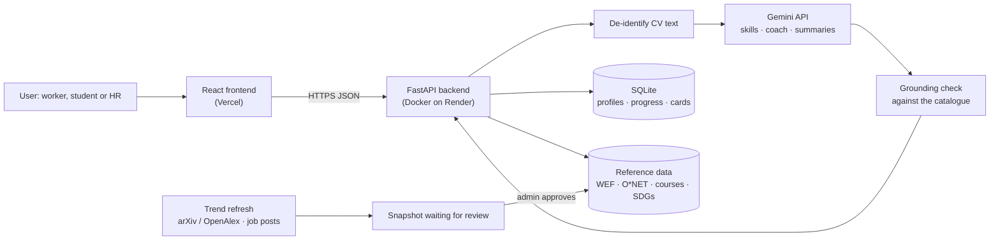

# SDC 2026 Hackathon · Phase 1: Preliminary Project Proposal

> Our answers to the official **SDC Hackathon Submission Template** (hosted by the XMUM AI Club; deadline 25 October 2026). The submitted PDF is named `SDC2026_MadeInUTM_Preliminary.pdf`. Fields marked ______ are filled in by the team leader before submission.

## 1. Team and project overview

| Field | Answer |
| --- | --- |
| Team name | Made in UTM |
| Selected domain | Domain 1: The Aiversecity Future-Ready Workforce |
| Selected SDG track (1–17) | **SDG 8** Decent Work and Economic Growth (targets 8.2, 8.5), with **SDG 4** Quality Education (targets 4.3, 4.4) |
| Project / solution name | **Laluan** (Malay for “path”): a career GPS for the AI era |
| Name (leader) | ______ |
| Email and phone (leader) | ______ |
| University affiliation(s) | ______ |
| Number of team members | ______ |
| Live prototype | <https://laluan-psi.vercel.app> |
| Code repository | <https://github.com/tanhongsheng050204-code/XMUM-HACKATHON> |

## 2. Executive summary and problem statement

### 2.1 The problem context *(250 words max)*

AI is changing which jobs exist faster than training programmes and skill frameworks can keep up. In Malaysia, 56% of professionals already use AI tools at work, yet only 26% have had formal training (Hays Asia Salary Guide 2025, cited in the Domain 1 brief), and MOSTI expects more than 600,000 workers to need reskilling within three to five years. Globally, the World Economic Forum expects a structural churn of 22% of formal jobs by 2030 (170 million created, 92 million displaced), with clerical roles shrinking fastest: data entry clerks by about 26% and administrative assistants by about 20% (Future of Jobs Report 2025, Figures 2.1 and 2.3).

Those affected first have the least room to experiment: clerks, customer-service staff and other routine-task workers, graduates choosing a first job, and HR teams deciding whom to reskill. Today they rely on static career lists that date quickly, one-off assessments, or generic chatbots whose advice cannot be traced to any source.

This matters socially and economically. A worker who reskills too late loses income and confidence; a graduate who trains for a shrinking role wastes time and money; a company that guesses wrong spends its training budget on the wrong skills. What is missing is guidance that is **personal, current, explainable and honest about uncertainty**: it should show which skills carry over, which roles are likely to grow under different AI-adoption futures, and an affordable plan to get there, without making the decision for the person.

*Word count: 244*

### 2.2 The proposed AI solution *(300 words max)*

Laluan takes a person from “who I am today” to “where I can be in the AI era” in minutes.

1. **Skills in.** The user uploads or pastes a CV, answers a questionnaire, or picks skills. Names, emails, phone and IC numbers are removed *before* any AI reads the text; the file is never stored. Dictionary matching, a generative model (Google Gemini) and embeddings find the skills; the user confirms them.
2. **Dated trend signals.** Each role starts from the WEF Future of Jobs 2025 growth figure. A re-runnable pipeline then adjusts it with AI-research momentum (arXiv/OpenAlex) and skill demand in job postings. Every update is saved as a new dated snapshot and **only goes live after a person approves it**.
3. **Explainable matching under three futures.** Roles are ranked under slow, baseline and accelerated AI adoption: 0.6 × skill fit + 0.4 × outlook, plus a small boost for the SDGs the user cares about. Every card shows “Why this rank?”, an estimate range and its source.
4. **A plan you can start this week.** Ordered courses for the missing skills, with hours, RM price and HRD Corp status, all from a curated catalogue. AI-written summaries are checked sentence by sentence against the catalogue so nothing is invented.
5. **An AI coach** answers questions about the user's own results with citations; it may suggest a change, but nothing happens until the user presses Apply.
6. **SDG impact, a shareable Future Card and an HR workforce view** (aggregate only, never a ranking of people).

From the SDC Phase 1 workshops we use: **GenAI APIs** (Gemini generation and embeddings, with an offline fallback), **database architecture** (SQLite for profiles, progress and shared cards; versioned JSON reference data) and **cloud deployment** (Docker container on Render, frontend on Vercel, CI on GitHub Actions).

*Word count: 296*

## 3. Technical architecture and implementation plan

### 3.1 Conceptual tech stack

| Layer | Technology |
| --- | --- |
| Frontend | React 18 + TypeScript + Vite; responsive; EN / BM / 中文; lite mode for slow connections |
| Backend API | Python 3.12, FastAPI, Pydantic |
| AI | Google Gemini API (`gemini-2.5-flash` for text, `gemini-embedding-001` for embeddings); rule-based offline mode when no key is set |
| Data | SQLite (profiles, progress, Future Cards); versioned JSON (roles, skills, courses, SDG map, O\*NET tasks, dated forecast snapshots) |
| Trend pipeline | arXiv API with OpenAlex fallback; Hacker News “Who is hiring?” threads via the Algolia HN API |
| Hosting | Vercel (frontend), Render (API as a Docker container, Singapore), GitHub Actions (tests and build on every push) |

**Sponsor resources:** ______ *(the team confirms whether any official SDC sponsor GenAI API or cloud credit was used; the prototype currently uses the public Gemini API, Vercel's free plan and Render's free plan.)*

### 3.2 Design-thinking and deployment strategy *(200 words max)*

**Empathise.** We started from the brief's three users and wrote personas: Aisyah, a data-entry clerk whose team just adopted an AI invoice reader; Wei Jie, a final-year student; and an HR team planning reskilling. Their fears shaped the tone: calm, honest, never alarmist.

**Define.** Success means a ranked, explainable plan in under five minutes, with every number traceable to a source.

**Ideate.** We rejected a pure chatbot: answers could not be checked. Instead, AI is used where it helps (reading CVs, explaining results) and every recommendation comes from cited data.

**Prototype and test.** The app has been live since Phase 1, and each round of browser testing fed back into the design: a phone layout fix, a “server waking up” notice, and a person-approval step for trend data. Every change is logged in REVIEW_LOG.md.

**Deploy.** Already deployed: Vercel for the frontend, a Docker container on Render for the API, with tests running on every push. It works without an API key, so the demo never depends on one provider. For Phase 2 we will finish the human evaluation, using the in-app review kit with a counsellor and native speakers.

*Word count: 189*

## 4. Preliminary environmental and SDG impact framework

| Metric category | Our response |
| --- | --- |
| **Target SDG sub-target(s)** | **8.5** “By 2030, achieve full and productive employment and decent work for all women and men, including for young people…”; **4.4** “By 2030, substantially increase the number of youth and adults who have relevant skills, including technical and vocational skills, for employment, decent jobs and entrepreneurship.” Supporting: 4.3 (affordable technical and vocational education), 8.2 (productivity through innovation). |
| **Current problem baseline** | Only **26%** of Malaysian professionals using AI at work have had formal AI training (Hays Asia Salary Guide 2025, as cited in the Domain 1 brief); **600,000+** Malaysian workers need reskilling within 3–5 years (MOSTI, same source); data-entry clerk jobs are projected to fall **≈26%** by 2030 (WEF Future of Jobs Report 2025, Fig. 2.3). For an individual today: no source-cited, personalised pathway exists in one place, so the share of recommendations a user can trace to a source is effectively **0%** in generic chatbot advice. |
| **Core measurable KPIs** | (1) Time from CV to a ranked, costed pathway (minutes). (2) Skill-extraction recall on 5 synthetic CVs marked by a person (%). (3) Share of role, skill, task and course recommendations that show a dated source (%). (4) Share of plan steps that are free or free to audit (%). (5) Reviewer agreement with the top-3 roles for the two personas (%). |
| **Phase 2 impact target** | (1) ≤ **5 minutes** in a timed run. (2) ≥ **80%** average recall. (3) **100%** of recommendations cited (already enforced by automated tests). (4) ≥ **70%** of steps free or free to audit in both demo pathways (currently 2 of 2 for Aisyah and 1 of 1 for Wei Jie). (5) ≥ **70%** reviewer agreement from a lecturer or career counsellor. |

**Sources:** World Economic Forum, *Future of Jobs Report 2025*, January 2025, Figures 2.1 and 2.3, <https://reports.weforum.org/docs/WEF_Future_of_Jobs_Report_2025.pdf>. SDC Hackathon, *Domain 1 Problem Statement & Marking Rubric* (citing Hays Asia Salary Guide 2025 and MOSTI). United Nations, *SDG targets 4.3, 4.4, 8.2, 8.5*, <https://sdgs.un.org/goals>.

## 5. Eligibility and readiness checklist

- [ ] All team members have completed the mandatory GenAI, Database and Cloud Deployment upskilling workshops. *(team to confirm)*
- [x] The project concept addresses a verified real-world problem mapped directly to one or more UN SDGs.
- [x] The proposed solution targets a functional, deployed application rather than a theoretical business case study. *(live at <https://laluan-psi.vercel.app>)*
- [ ] All fields in this template have been completed within the word limits stated. *(tick once the ______ fields are filled)*

## 6. IP and originality declaration

### 6.1 Pre-existing / prior-owned work

**______ (Yes / No).** *Team to confirm: the draft AI declaration notes that “some utility functions were adapted from team members' earlier personal projects”. If that is true, name them here with their owner; otherwise answer No and remove the note from AI_DECLARATION.md.*

### 6.2 Third-party code, datasets or models

**Yes.** All are open source or public and are used under their licences, with attribution in the README:

| Type | Name | Licence |
| --- | --- | --- |
| Code | React 18.3.1, React DOM 18.3.1 | MIT |
| Code | Vite 5.4.11, @vitejs/plugin-react 4.3.4 | MIT |
| Code | TypeScript 5.6.3 | Apache-2.0 |
| Code | qrcode 1.5.4 | MIT |
| Font | Inter (via @fontsource-variable/inter 5.3.0) | SIL OFL 1.1 |
| Code | FastAPI, Starlette, Pydantic | MIT / BSD-3 / MIT |
| Code | Uvicorn, HTTPX, pypdf | BSD-3 |
| Code | python-multipart, google-genai SDK | Apache-2.0 |
| Code | PyMuPDF (only for the one-off WEF figure extraction script, not in the app) | AGPL-3.0 |
| Dataset | O\*NET 30.0 task statements (U.S. Department of Labor) | CC BY 4.0 |
| Dataset | WEF Future of Jobs Report 2025, Figure 2.3 (figures cited, not redistributed as a dataset) | WEF terms of use, with citation |
| Dataset | UN Sustainable Development Goals names, targets and colours | UN SDG guidelines |
| Dataset | arXiv API metadata counts; OpenAlex | arXiv API terms; CC0 |
| Dataset | Hacker News “Who is hiring?” posts, counted via the Algolia HN API | HN API terms (counts only, no posts stored) |
| Images | Three landing-page photos from Unsplash (Gema Saputera, Mimi Thian, Vitaly Gariev) | Unsplash License |
| Model | Google Gemini `gemini-2.5-flash`, `gemini-embedding-001` (pre-trained, called via API) | Gemini API terms |

### 6.3 Employment-related IP conflicts

**______ (Yes / No).** *Team to confirm for every member.*

## 7. Declaration

By submitting this proposal, the team leader confirms that the information provided is accurate to the best of the team's knowledge and that the project will be original work created during the SDC 2026 hackathon period.

Signature: ______ Date: ______
