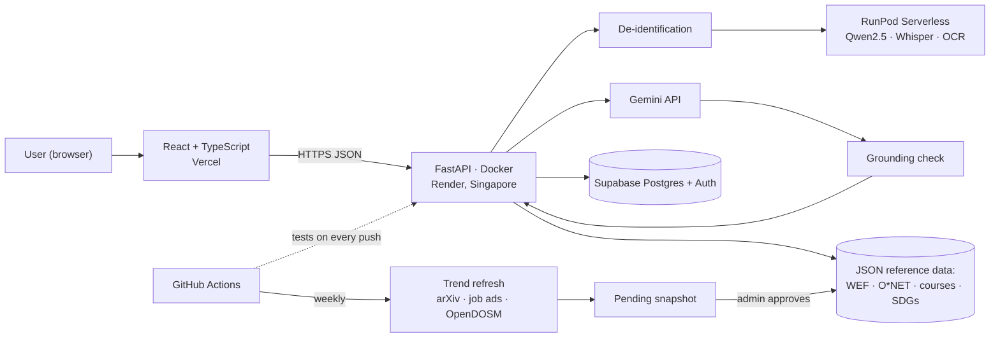

# SDC 2026 Hackathon · Technical Tools Declaration

> Our answers to the official **SDC Hackathon Technical Tools Declaration Template**. This file is the source text; the submitted form is [`submission/SDC2026_MadeInUTM_TechDeclaration.pdf`](../../submission/SDC2026_MadeInUTM_TechDeclaration.pdf). No API keys or secrets appear in this document or in the repository.

## 1. Team and project overview

| Field | Answer |
| --- | --- |
| Team name | Made in UTM |
| Project / solution name | Laluan: a career GPS for the AI era |
| Name (leader) | Tan Hong Sheng |
| Email and phone (leader) | tanhongsheng050204@gmail.com (phone as on the registration form) |
| University affiliation(s) | Universiti Teknologi Malaysia (UTM) |
| Live prototype URL | <https://laluan-psi.vercel.app> (API: <https://laluan-api.onrender.com/docs>) |
| Code repository URL | <https://github.com/tanhongsheng050204-code/SDC-HACKATHON-2026-XMUM---Made-In-UTM> (public) |

## 2. Architecture and technology stack

### 2.1 System architecture overview *(200 words max)*

The user opens a React single-page app on **Vercel**. It calls a **FastAPI** backend over HTTPS, running as a **Docker** container on **Render** (Singapore). Profiles, progress, trend snapshots and optional logins live in **Supabase** (Postgres and Auth, Singapore).

A CV is read in memory. Scans go through our own OCR (on **RunPod Serverless**, else on the server), then names, emails, phone and IC numbers are removed. An open model, **Qwen2.5-7B-Instruct on RunPod**, reads skills from the scrubbed text, and **faster-whisper on RunPod** transcribes voice input. **Google Gemini** writes coach answers, interview feedback and summaries; every sentence is checked against our sources before it is shown. Without keys, rules and templates take over.

Matching, forecasts, scenarios and pathways are plain Python over versioned **JSON reference data** (WEF, O\*NET, courses, SDG map), with no AI call.

**GitHub Actions** runs the tests on every push and a weekly trend refresh that collects arXiv/OpenAlex, freehire.me job ads, Hacker News, Stack Overflow, GitHub, npm, PyPI and OpenDOSM. Each new dated snapshot goes live only after an admin approves it. A diagram is in the appendix.

*Word count: 179*

### 2.2 Languages, frameworks and libraries

Languages: TypeScript, Python 3.12, CSS, SQL (Postgres; SQLite locally).

| Name and version | Purpose in project | Licence |
| --- | --- | --- |
| React 18.3.1, React DOM 18.3.1 | User interface | MIT |
| TypeScript 5.6.3 | Typed frontend code | Apache-2.0 |
| Vite 5.4.11, @vitejs/plugin-react 4.3.4 | Frontend dev server and build | MIT |
| @supabase/supabase-js 2.45.4 | Google or Microsoft login in the browser | MIT |
| qrcode 1.5.4 | QR code on the shareable Future Card | MIT |
| @fontsource-variable/inter 5.3.0 (Inter font) | Self-hosted typeface | SIL OFL 1.1 |
| FastAPI 0.148.0 (Starlette 1.9.0) | HTTP API | MIT / BSD-3 |
| Pydantic 2.14.1 | Request validation (also rejects demographic fields) | MIT |
| Uvicorn 0.54.0 | ASGI server | BSD-3 |
| psycopg 3.3.6 | Supabase Postgres connection | LGPL-3.0 |
| PyJWT 2.15.1 | Checking Supabase login tokens | MIT |
| google-genai 1.75.0 | Gemini API client | Apache-2.0 |
| HTTPX 0.28.1 | Calls to RunPod and the trend sources | BSD-3 |
| pypdf 6.21.1 | Reading uploaded PDF CVs in memory | BSD-3 |
| RapidOCR 2.1.0, ONNX Runtime 1.31.0, pypdfium2 5.14.0, Pillow 13.0.0 | Our own OCR for scanned CVs and photos (RunPod worker first, else the API server) | Apache-2.0 / MIT / Apache-2.0 / MIT-CMU |
| runpod SDK 1.7 | The OCR worker's serverless handler | MIT |
| python-multipart 0.0.32 | CV file uploads | Apache-2.0 |
| sentry-sdk 2.72.0, @sentry/react 8.38.0 | Optional error reports, personal data removed | MIT |
| pytest 8.4.2, Vitest 2.1.8, Testing Library, axe-core 4.10.2 | Tests and accessibility checks (development only) | MIT / MIT / MIT / MPL-2.0 |
| PyMuPDF | One-off script that reads WEF Figure 2.3 from the report PDF; not part of the app | AGPL-3.0 |
| Python 3.12-slim, Node 20, nginx 1.27 (Docker images) | API container and local `docker compose` run | PSF / MIT / BSD-2 |

## 3. APIs and cloud services

### 3.1 External APIs

| API and provider | Purpose in project | Access tier |
| --- | --- | --- |
| Gemini API (Google): `gemini-3.8-flash`, `gemini-embedding-001` | Coach answers, interview feedback, proof-check questions, summaries, embeddings for unfamiliar skill phrases. The app runs without it. | Free |
| RunPod Serverless API | Qwen2.5-7B-Instruct reads skills from scrubbed CV text; faster-whisper transcribes voice; our OCR worker reads scans | Sponsor-provided credits |
| Supabase (Postgres and Auth) | Database and optional Google or Microsoft login | Free |
| arXiv API (Cornell University) | AI research papers per capability, for trend signals | Free |
| OpenAlex API (OurResearch) | Fallback paper counts, and AI papers with a Malaysian institution | Free |
| freehire.me public API | Malaysian job ads: skill and role counts, and the newest openings with links to the original postings | Free, no key |
| Hacker News Search API (Algolia) | Skill mentions in “Who is hiring?” threads | Free |
| Stack Exchange, GitHub, npm and PyPI Stats APIs | Developer attention per skill | Free |
| OpenDOSM / data.gov.my API (Department of Statistics Malaysia) | Labour force, employment by sector, consumer prices and salaries | Free |
| Gmail SMTP (Google) | Weekly digest and job-alert emails the user asked for | Free |

Job-search links (MYFutureJobs, JobStreet, LinkedIn) are plain links that open in the browser; the app does not call those services.

### 3.2 Cloud platforms and deployment

| Service and provider | Purpose in project | Plan / region |
| --- | --- | --- |
| Vercel | Hosts the built React frontend (<https://laluan-psi.vercel.app>) | Hobby (free), global edge |
| Render | Runs the FastAPI backend as a Docker container (`render.yaml`, `backend/Dockerfile`) | Free web service, Singapore |
| Supabase | Postgres for profiles, progress, Future Cards, trend snapshots and review decisions (row-level security on); login through Supabase Auth | Free, Singapore |
| RunPod Serverless | Open models for CV reading (Qwen2.5-7B-Instruct on vLLM), voice (faster-whisper) and our OCR worker (`runpod/ocr`), so raw CV text and audio stay away from Google | Sponsor credits, pay per second |
| Replit | Development workspace and an alternative host for the same code | Sponsor-provided |
| GitHub and GitHub Actions | Public repository; tests on every push; scheduled jobs (keep-awake ping, weekly trend refresh, digest and job alerts) | Free |
| Docker / Docker Compose | One-command local run of the whole app (`docker compose up --build`) | Local |

## 4. AI tools, models and datasets

### 4.1 AI models used in the solution

| Model and version | Source / provider | Usage | Licence / terms |
| --- | --- | --- | --- |
| Gemini 3.8 Flash (`gemini-3.8-flash`) | Google, via the Gemini API | Pre-trained, called by API | Gemini API Terms of Service |
| Gemini Embedding (`gemini-embedding-001`) | Google, via the Gemini API | Pre-trained, called by API | Gemini API Terms of Service |
| Qwen2.5-7B-Instruct | Alibaba Qwen team, served with vLLM on RunPod Serverless | Pre-trained, self-hosted | Apache-2.0 |
| Whisper `small` (faster-whisper) | OpenAI / SYSTRAN, on RunPod Serverless | Pre-trained, self-hosted | MIT |
| PaddleOCR PP-OCRv4 English recogniser and RapidOCR text detector | PaddlePaddle / RapidAI, run in our OCR worker | Pre-trained, self-hosted | Apache-2.0 |

No model is trained or fine-tuned by the team. The model in use is shown in the app's footer and at `/api/health`.

### 4.2 Datasets

| Dataset name | Source / URL | Type | Licence | Personal data? |
| --- | --- | --- | --- | --- |
| WEF Future of Jobs Report 2025, Figure 2.3 (net job growth 2025–2030, 126 occupations) | <https://reports.weforum.org/docs/WEF_Future_of_Jobs_Report_2025.pdf> | Public | WEF terms of use; cited on every role | N |
| O\*NET 30.0 task statements | <https://www.onetcenter.org/> | Public | CC BY 4.0 | N |
| UN SDG goals, targets and colours | <https://sdgs.un.org/goals> | Public | UN SDG guidelines | N |
| OpenDOSM labour force, employment by sector, consumer prices, salaries; DOSM Salaries & Wages 2025 | <https://open.dosm.gov.my> | Public | CC BY 4.0 | N |
| arXiv and OpenAlex paper counts | <https://export.arxiv.org/api/>, <https://openalex.org/> | Public (counts only) | arXiv API terms; CC0 | N |
| Malaysian job postings | <https://freehire.me/docs/api> | Public (counts stored; postings shown live with links) | freehire terms; project MIT | N |
| Hacker News “Who is hiring?” skill mentions | <https://hn.algolia.com/api> | Public (counts only) | HN / Algolia API terms | N |
| Stack Overflow, GitHub, npm and PyPI activity | Each service's public API | Public (counts only) | Each API's terms | N |
| Anthropic Economic Index | <https://huggingface.co/datasets/Anthropic/EconomicIndex> | Public (aggregates) | CC BY | N |
| OpenAI “GPTs are GPTs” occupation exposure scores | <https://github.com/openai/GPTs-are-GPTs> | Public | MIT | N |
| ILO Working Paper 140, Annex Table A1 | <https://www.ilo.org/publications/generative-ai-and-jobs-refined-global-index-occupational-exposure> | Public | CC BY 4.0 | N |
| MyCOL 2024/2025 (TalentCorp critical occupations) | <https://www.talentcorp.com.my/mycol/> | Public report | Cited with link | N |
| Course catalogue (prices, hours, HRD Corp status) | Providers' own pages, dated in `backend/data/courses.json` | Self-collected | Facts with links to the providers | N |
| Roles, skills and SDG map | `backend/data/` | Self-created | Apache-2.0 (this repository) | N |
| Demo personas, evaluation CVs, sample company (190 people) and class (52 students) | `backend/data/` | Synthetic | Apache-2.0 (this repository) | N (all invented) |
| Landing-page photos (3) | Unsplash: Gema Saputera, Mimi Thian, Vitaly Gariev | Public | Unsplash License | N (not linked to any data) |

### 4.3 AI-assisted development tools

Did the team use any generative-AI tool to help create code, design, text or other project material? **Yes.**

| Tool and version | Used for | Extent of use |
| --- | --- | --- |
| Claude Code (Anthropic), with Claude Opus models | Planning documents; writing and refactoring backend and frontend code and tests; screen layouts (modelled on a reference site the team chose); Docker and deployment files; extracting WEF figures; BM and Chinese interface text; the demo GIFs, pitch deck and these declarations | Major |
| Google Gemini (inside the product) | Drafting automate / assist / human labels for O\*NET tasks, each reviewed by a person | Moderate |

**How the team reviewed, tested and took responsibility for AI-generated output** *(100 words max)*

The team chose the problem framing, users, features, design reference and data sources, and directed every change. AI-written code ships only with tests: about 490 automated backend tests, frontend component tests, a type-checked build and lint, and CI on every push (on SQLite and Postgres). Each feature was clicked through in a browser. Each problem found, and the fix, is logged in REVIEW_LOG.md, and design choices with their alternatives are in DECISIONS.md. Inside the app, AI never acts alone: the coach only suggests, trend updates need an admin's approval, and AI-written text is checked against our sources.

*Word count: 94*

## 5. Sponsor-provided resources

Did the project use any official SDC sponsor-provided resource? **Yes.**

| Sponsor | Resource (API / credits / platform / data) | How it was used in the project |
| --- | --- | --- |
| RunPod | Serverless GPU credits and API | Qwen2.5-7B-Instruct reads skills from scrubbed CV text, faster-whisper transcribes voice input, and our OCR worker (`runpod/ocr`) reads scanned CVs |
| Replit | Platform | Development workspace and an alternative host for the same code |

**Was the sponsor resource essential to the core functionality, or could it be replaced?** *(100 words max)*

Replaceable, by design. RunPod lets CV text and voice stay away from Google, with open models we choose, but if an endpoint is down or not set, Gemini or the dictionary reader reads the CV, the server's own OCR reads scans, and the browser's speech input replaces Whisper. Replit is one place the app runs; the same code runs on Vercel and Render, or locally with Docker. The core route (matching, forecasts, scenarios and pathways) is plain calculation and needs no sponsor resource.

*Word count: 83*

## 6. Security, privacy and responsible use

### 6.1 Data handling and privacy *(150 words max)*

**Collected:** confirmed skills, current role, years of experience, goals, SDG choices and course progress, under a random profile ID in Supabase (Singapore). An account (Google or Microsoft login) is optional; an email address is kept only while the user has emails or job alerts switched on. The API rejects age, gender and background fields.

**CVs:** read in memory and never stored. Names, emails, phone and IC numbers are removed before any AI (RunPod or Gemini) sees the text, and the user sees exactly what will be sent.

**Retention:** profiles not saved to an account are deleted after 30 days unused, demo copies after a day. Users can download or delete everything at any time.

**Protection:** HTTPS, row-level security, saved profiles open only through their login, logged admin actions, no IP addresses or profile IDs in logs. HR uploads with personal columns are refused; results are totals only.

*Word count: 145*

### 6.2 Known limitations and risks *(150 words max)*

- **Hallucination:** AI text could invent courses or numbers. Mitigation: courses, roles and figures come only from reference data, and every AI sentence is checked against those sources and rewritten or removed if unsupported.
- **Forecast uncertainty:** WEF figures are global employer-survey estimates. Mitigation: Malaysian signals, three scenarios, 80% ranges, the word “estimate”, a published backtest and a dated source on every card.
- **Noisy trend signals:** job-ad data is tech-heavy. Mitigation: capped adjustments, minimum counts, shrinkage towards no change, and a person approves each update.
- **Bias:** no demographic inputs; CI checks that eight names from Malaysia's communities get identical results.
- **Provider dependence and rate limits:** arXiv falls back to OpenAlex; RunPod falls back to Gemini; everything runs without any AI key.
- **Free hosting:** the API can sleep when idle (about a minute to wake); the app shows a notice and retries.

*Word count: 146*

## 7. Compliance and readiness

- [x] All APIs, cloud services, AI tools, models and datasets used in the project are declared in this document.
- [x] All third-party code, datasets and models are used in accordance with their licences, and attribution is provided where required.
- [x] No API keys, passwords or other credentials are exposed in the code repository, prototype or this document.
- [x] Any use of generative-AI tools for development has been disclosed and reviewed by the team.
- [x] Any use of official SDC sponsor resources has been declared in Section 5.
- [x] The prototype described here is accessible to judges through the links provided in Section 1.
- [x] All fields in this template have been completed within the word limits stated.

## 8. Declaration

By submitting this document, the team leader confirms that the information provided is complete and accurate to the best of the team's knowledge, and that every API, cloud service, AI tool, dataset, model and sponsor resource used in the project has been declared.

Signature: Tan Hong Sheng (Team Leader, typed) Date: 24 October 2026

## Appendix: system block diagram

