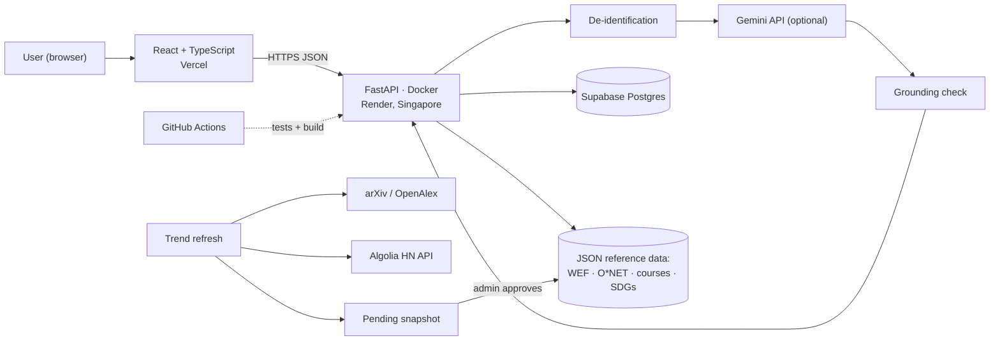

# SDC 2026 Hackathon · Technical Tools Declaration

> Our answers to the official **SDC Hackathon Technical Tools Declaration Template**. The submitted PDF is named `SDC2026_MadeInUTM_TechDeclaration.pdf`. Fields marked ______ are filled in by the team leader before submission. No API keys or secrets appear in this document or in the repository.

## 1. Team and project overview

| Field | Answer |
| --- | --- |
| Team name | Made in UTM |
| Project / solution name | Laluan: a career GPS for the AI era |
| Name (leader) | ______ |
| Email and phone (leader) | ______ |
| University affiliation(s) | ______ |
| Live prototype URL | <https://laluan-psi.vercel.app> (API: <https://laluan-api.onrender.com/docs>) |
| Code repository URL | <https://github.com/tanhongsheng050204-code/XMUM-HACKATHON> (public) |

## 2. Architecture and technology stack

### 2.1 System architecture overview *(200 words max)*

The user opens a React single-page app served by **Vercel**. It calls a **FastAPI** backend over HTTPS; the backend runs as a **Docker** container on **Render** (Singapore).

When a CV arrives, the backend reads it in memory, removes names, emails, phone and IC numbers, and finds skills with a dictionary. If a Gemini key is set, it also asks **Google Gemini** to read the scrubbed text and uses Gemini embeddings for unfamiliar phrases. Without a key, everything runs on rules and templates.

Matching, scenarios and pathways are deterministic Python over versioned **JSON reference data**: WEF growth figures, O\*NET tasks, the course catalogue and the SDG map. Profiles, course progress and shared Future Cards are kept in **SQLite**. AI-written text (coach answers, pathway summaries) passes a grounding check against these sources before it is shown.

A trend pipeline counts research papers (**arXiv**, falling back to **OpenAlex**) and job-posting mentions (**Algolia Hacker News API**, and Malaysian postings on **freehire.me**), builds a new dated snapshot and holds it until an admin approves it.

**GitHub Actions** runs the backend tests and the frontend build on every push. A diagram is in the appendix.

*Word count: 185*

### 2.2 Languages, frameworks and libraries

Languages: TypeScript, Python 3.12, CSS, SQL (SQLite).

| Name and version | Purpose in project | Licence |
| --- | --- | --- |
| React 18.3.1, React DOM 18.3.1 | User interface | MIT |
| TypeScript 5.6.3 | Typed frontend code | Apache-2.0 |
| Vite 5.4.11, @vitejs/plugin-react 4.3.4 | Frontend dev server and build | MIT |
| qrcode 1.5.4 | QR code on the shareable Future Card | MIT |
| @fontsource-variable/inter 5.3.0 (Inter font) | Self-hosted typeface | SIL OFL 1.1 |
| FastAPI 0.148.0 (Starlette 1.9.0) | HTTP API | MIT / BSD-3 |
| Pydantic 2.14.1 | Request validation (also rejects demographic fields) | MIT |
| Uvicorn 0.54.0 | ASGI server | BSD-3 |
| google-genai 1.75.0 | Gemini API client | Apache-2.0 |
| HTTPX 0.28.1 | Calls to arXiv, OpenAlex, HN Algolia | BSD-3 |
| pypdf 6.21.1 | Reading uploaded PDF CVs in memory | BSD-3 |
| RapidOCR 2.1, ONNX Runtime, pypdfium2, PaddleOCR PP-OCRv4 English recogniser | Reading scanned CVs and photos with our own OCR (our RunPod worker first, else the API server), before scrubbing | Apache-2.0 / MIT / Apache-2.0 |
| python-multipart 0.0.32 | CV file uploads | Apache-2.0 |
| pytest 8.4.2 | Backend tests (development only) | MIT |
| PyMuPDF | One-off script that reads WEF Figure 2.3 from the report PDF; not part of the app | AGPL-3.0 |
| nginx 1.27, Node 20, Python 3.12-slim (Docker images) | Local `docker compose` run and the API container | BSD-2 / MIT / PSF |

## 3. APIs and cloud services

### 3.1 External APIs

| API and provider | Access tier | Purpose in project |
| --- | --- | --- |
| Gemini API (Google): `gemini-3.8-flash`, `gemini-embedding-001` | Free tier, optional *(team to confirm whether a sponsor key is used)* | Reading skills from scrubbed CV text, coach answers, pathway summaries, embeddings for unfamiliar skill phrases. The app runs fully without it (offline rules and templates). |
| arXiv API (Cornell University) | Free | Counting AI research papers per capability for trend signals |
| OpenAlex API (OurResearch) | Free | Fallback paper counts when arXiv is busy |
| Hacker News Search API (Algolia) | Free | Counting skill mentions in “Who is hiring?” threads |
| freehire.me public API (open source, MIT) | Free, no key | Counting skill mentions in Malaysian job postings, and showing the newest openings for each role with links to the original postings |

Job-search links (MYFutureJobs, JobStreet, LinkedIn) are plain links that open in the browser; the app does not call those services.

### 3.2 Cloud platforms and deployment

| Service and provider | Plan / region | Purpose in project |
| --- | --- | --- |
| Vercel | Hobby (free), global edge | Hosts the built React frontend; `VITE_API_URL` points to the API |
| Render | Free web service, Singapore | Runs the FastAPI backend as a Docker container (from `render.yaml` and `backend/Dockerfile`) |
| Supabase | Free, Singapore | Postgres for profiles, progress, Future Cards, trend snapshots and review decisions (row-level security on); Google login through Supabase Auth |
| RunPod Serverless | Pay per second (US$25 credit) | Optional: an open model (Qwen2.5-7B) reads CVs and Whisper transcribes voice, so raw CV text and audio stay away from Google |
| GitHub | Free, public repository | Source code; GitHub Actions runs tests and the build on every push |
| Docker / Docker Compose | Local | One-command local run of the whole app (`docker compose up --build`) |

## 4. AI tools, models and datasets

### 4.1 AI models used in the solution

| Model and version | Source / provider | Licence / terms | Usage |
| --- | --- | --- | --- |
| Gemini 3.8 Flash (`gemini-3.8-flash`) | Google, via the Gemini API | Gemini API Terms of Service | Pre-trained, called by API (optional) |
| Gemini Embedding (`gemini-embedding-001`) | Google, via the Gemini API | Gemini API Terms of Service | Pre-trained, called by API (optional) |

No model is trained or fine-tuned by the team. The model in use is shown in the app's sidebar and footer. The deployed demo currently runs in offline mode, with no model.

### 4.2 Datasets

| Dataset name | Source / URL | Type | Personal data? | Licence |
| --- | --- | --- | --- | --- |
| WEF Future of Jobs Report 2025, Figure 2.3 (net job growth 2025–2030, 126 occupations) | <https://reports.weforum.org/docs/WEF_Future_of_Jobs_Report_2025.pdf> | Public | N | WEF terms of use; cited on every role |
| O\*NET 30.0 task statements | <https://www.onetcenter.org/> | Public | N | CC BY 4.0 |
| UN SDG goals, targets and colours | <https://sdgs.un.org/goals> | Public | N | UN SDG guidelines |
| arXiv paper counts per AI capability | <https://export.arxiv.org/api/> | Public (counts only) | N | arXiv API terms |
| OpenAlex paper counts (fallback) | <https://openalex.org/> | Public (counts only) | N | CC0 |
| Hacker News “Who is hiring?” skill-mention counts | <https://hn.algolia.com/api> | Public (counts only; no posts stored) | N | HN / Algolia API terms |
| Malaysian job postings (skill-mention counts, newest openings per role) | <https://freehire.me/docs/api> | Public (counts stored; postings shown live with links, not stored) | N | freehire terms; project MIT |
| Anthropic Economic Index (observed AI exposure by occupation, task-level automation vs augmentation, Malaysia usage) | <https://huggingface.co/datasets/Anthropic/EconomicIndex> | Public (aggregates) | N | CC BY |
| OpenAI “GPTs are GPTs” occupation exposure scores (2023) | <https://github.com/openai/GPTs-are-GPTs> | Public | N | MIT |
| ILO Working Paper 140, Annex Table A1 (exposure by ISCO-08 occupation) | <https://www.ilo.org/publications/generative-ai-and-jobs-refined-global-index-occupational-exposure> | Public | N | CC BY 4.0 |
| MyCOL 2024/2025 (TalentCorp critical occupations list) | <https://www.talentcorp.com.my/mycol/> | Public report (matches by job title, linked) | N | Cited with link |
| Course catalogue (38 courses, prices and HRD Corp status) | Providers' own pages, dated in `backend/data/courses.json` | Self-collected | N | Facts with links to the providers |
| Roles, skills and SDG map | `backend/data/` | Self-created | N | Apache-2.0 (this repository) |
| Demo personas (Aisyah, Wei Jie) and 5 evaluation CVs | `backend/data/demo_profiles.json`, `backend/data/eval/` | Synthetic | N (all invented) | Apache-2.0 (this repository) |
| Sample company for the workforce view (190 people) | `backend/data/sample_workforce.csv` | Synthetic | N (roles and skills only) | Apache-2.0 (this repository) |
| Landing-page photos (3) | Unsplash: Gema Saputera, Mimi Thian, Vitaly Gariev | Public | Shows people; not linked to any data | Unsplash License |

### 4.3 AI-assisted development tools

Did the team use any generative-AI tool to help create code, design, text or other project material? **Yes.**

| Tool and version | Extent of use | Used for |
| --- | --- | --- |
| Claude Code (Anthropic), with Claude Opus models | Major | Drafting planning documents; writing and refactoring backend and frontend code and tests; the landing page and app screen layout (modelled on a reference site the team chose); Docker and deployment files; extracting WEF figures; drafting BM and Chinese interface text; drafting these declarations |
| Google Gemini (inside the product) | Moderate | Drafting automate / assist / human labels for O\*NET tasks, for later human review |
| ______ | ______ | *(team adds any other tools used, e.g. ChatGPT, GitHub Copilot, Canva AI)* |

**How the team reviewed, tested and took responsibility for AI-generated output** *(100 words max)*

The team chose the problem framing, users, features, design reference and data sources, and directed every change. AI-written code ships only with tests: 297 automated backend tests, a type-checked frontend build, and CI on every push. Each feature was clicked through in a browser, including on phone width. Each problem found, and the fix, is logged in REVIEW_LOG.md, and design choices with their alternatives are in DECISIONS.md. Inside the app, AI never acts alone: the coach only suggests, trend updates need an admin's approval, and AI-written text is checked against the course catalogue.

*Word count: 93*

## 5. Sponsor-provided resources

Did the project use any official SDC sponsor-provided resource? **______ (Yes / No).** *Team to confirm. As built, the prototype uses only free public services (Gemini API free tier when a key is set, Vercel Hobby, Render free). If a sponsor key or credits are used, list them here.*

| Sponsor | Resource (API / credits / platform / data) | How it was used in the project |
| --- | --- | --- |
| ______ | ______ | ______ |

**Was the sponsor resource essential to the core functionality, or could it be replaced?** *(100 words max)*

No single provider is essential. Every AI feature has an offline path: dictionary skill matching, template pathways and a rule-based coach. The deployed demo works with no API key, so a GenAI API makes CV reading and explanations richer but is not required. Hosting is plain Docker plus a static frontend, so Render and Vercel could be swapped for any container host and static host without code changes.

*Word count: 68*

## 6. Security, privacy and responsible use

### 6.1 Data handling and privacy *(150 words max)*

**Collected:** the skills a person confirms, their current role, years of experience, chosen SDG goals and course progress, stored in SQLite under a random profile ID. No account, name, email or demographic data is required; the API rejects age, gender and background fields.

**CVs:** read in memory and never stored. Names, emails, phone and Malaysian IC numbers are removed before any text is sent to an AI API.

**Third parties:** only scrubbed CV text and questions about a person's own results go to the Gemini API, and only when a key is set.

**Retention:** profiles can be deleted at any time from the app, which also deletes their Future Cards; `cleanup.py` removes profiles untouched for 30 days, and the free host resets its database on each redeploy.

**Workforce view:** CSV files with name, email, IC, phone or staff-ID columns are refused; results are totals by role only.

*Word count: 147*

### 6.2 Known limitations and risks *(150 words max)*

- **Hallucination:** AI text could invent courses or numbers. Mitigation: courses, roles and figures come only from reference data, and every AI sentence is checked against those sources and flagged if unsupported.
- **Forecast uncertainty:** WEF figures are global employer-survey estimates, not Malaysian statistics. Mitigation: three scenarios, a low–high range on every role, the word “estimate”, and a dated source on every card.
- **Noisy trend signals:** job-posting data is tech-heavy. Mitigation: capped adjustments, minimum mention counts, and a person approves each update.
- **Bias:** no demographic inputs are accepted; tests confirm names do not change rankings.
- **Provider dependence and rate limits:** arXiv falls back to OpenAlex; the whole app runs offline without Gemini.
- **Free hosting:** the API sleeps when idle (about a minute to wake); the app shows a notice and retries.

*Word count: 130*

## 7. Compliance and readiness

- [x] All APIs, cloud services, AI tools, models and datasets used in the project are declared in this document.
- [x] All third-party code, datasets and models are used in accordance with their licences, and attribution is provided where required.
- [x] No API keys, passwords or other credentials are exposed in the code repository, prototype or this document.
- [x] Any use of generative-AI tools for development has been disclosed and reviewed by the team.
- [ ] Any use of official SDC sponsor resources has been declared in Section 5. *(tick after Section 5 is confirmed)*
- [x] The prototype described here is accessible to judges through the links provided in Section 1.
- [ ] All fields in this template have been completed within the word limits stated. *(tick once the ______ fields are filled)*

## 8. Declaration

By submitting this document, the team leader confirms that the information provided is complete and accurate to the best of the team's knowledge, and that every API, cloud service, AI tool, dataset, model and sponsor resource used in the project has been declared.

Signature: ______ Date: ______

## Appendix: system block diagram

